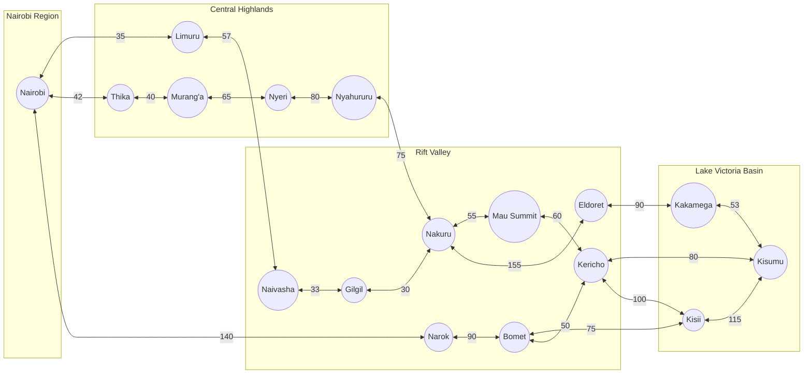
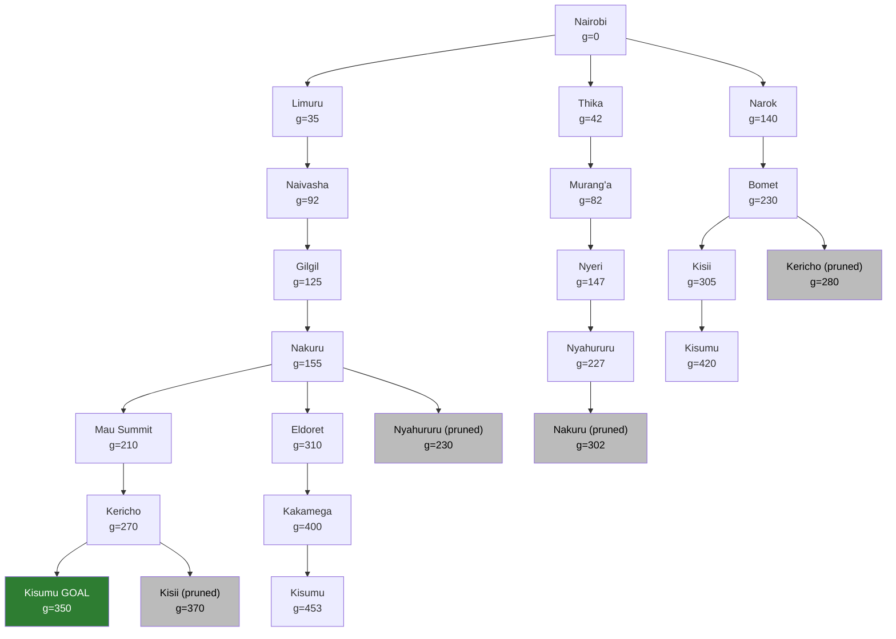

# ICS 3202: Artificial Intelligence
## Practical Exercise 3: Designing a Searching Agent (Self-Driving Trailer)

**Group members:**  Wario Louis Maina-190124
                    Ongoma Derrick Omondi-182842
                    Muhoro Benedict Kuria-171534

> **Note on distances:** All road distances below are approximate highway distances in kilometres. Replace them with the exact values from the Google Maps search feature before submitting.

---

## Question 1: Agent Design Using the PEAS Framework

PEAS stands for Performance measure, Environment, Actuators, Sensors.

| Component | Description |
|---|---|
| **Performance measure** | Shortest total distance travelled; safe arrival with zero collisions; delivery of cargo undamaged; obeying traffic laws and speed limits; low fuel consumption; timely arrival |
| **Environment** | Kenya's highway network across Nairobi, Central Highlands, Rift Valley and Lake Victoria Basin: tarmac roads, other vehicles, pedestrians, animals, junctions, traffic signs, weather, road works, police checkpoints |
| **Actuators** | Steering, accelerator, brakes, gear selection, indicators, headlights, horn, windscreen wipers, trailer coupling brakes |
| **Sensors** | Global Positioning System receiver, cameras, radar, Light Detection and Ranging (lidar), speedometer, odometer, fuel gauge, trailer load sensors, road map database, microphone for sirens |

### Environment Properties (Five Definitions of Agent Environments)

| Property | Classification | Justification |
|---|---|---|
| **Observability** | Partially observable | Sensors see only nearby surroundings; the agent cannot see traffic jams, accidents or road closures far ahead |
| **Determinism** | Stochastic | Other drivers, weather and road conditions are unpredictable, so the same action does not always give the same result |
| **Episodic vs sequential** | Sequential | Each decision (route choice, turning, braking) affects all future decisions and the final outcome |
| **Static vs dynamic** | Dynamic | The environment changes while the agent is deciding: vehicles move, traffic lights change, weather shifts |
| **Discrete vs continuous** | Continuous (for driving) and discrete (for route planning) | Speed, position and steering angle are continuous; the road map is a discrete set of towns and roads |
| **Number of agents** | Multi-agent (competitive and cooperative) | Other drivers, pedestrians and police share the roads and affect each other |

> If your lecturer's five definitions did not include "number of agents", delete that row.

---

## Question 2: Directed Graph and Search Tree

### Abstraction Applied

Abstraction means removing irrelevant detail to make the problem solvable:

- Towns become **nodes (states)**; only major towns on highways are kept.
- Highways become **edges (actions)** weighted by road distance in kilometres.
- Ignored details: road curves, lanes, traffic, weather, junction layouts, fuel stops, minor roads and villages.
- Every two-way road is represented as **two directed edges** (one in each direction).
- Regions are labelled: Nairobi, Central Highlands, Rift Valley, Lake Victoria Basin.

### Problem Formulation

| Element | Definition |
|---|---|
| **Initial state** | In Nairobi |
| **Actions** | Drive along a highway to an adjacent town |
| **Transition model** | Driving from town A to town B along a road results in being in town B |
| **Goal test** | Current town is Kisumu |
| **Path cost** | Sum of distances in kilometres between towns |

### Distance Table (Kilometres, Approximate)

| From | To | Distance | Region of destination |
|---|---|---|---|
| Nairobi | Limuru | 35 | Central Highlands |
| Nairobi | Thika | 42 | Central Highlands |
| Nairobi | Narok | 140 | Rift Valley |
| Limuru | Naivasha | 57 | Rift Valley |
| Thika | Murang'a | 40 | Central Highlands |
| Murang'a | Nyeri | 65 | Central Highlands |
| Nyeri | Nyahururu | 80 | Central Highlands |
| Naivasha | Gilgil | 33 | Rift Valley |
| Gilgil | Nakuru | 30 | Rift Valley |
| Nyahururu | Nakuru | 75 | Rift Valley |
| Nakuru | Mau Summit | 55 | Rift Valley |
| Nakuru | Eldoret | 155 | Rift Valley |
| Mau Summit | Kericho | 60 | Rift Valley |
| Kericho | Kisumu | 80 | Lake Victoria Basin |
| Kericho | Kisii | 100 | Lake Victoria Basin |
| Eldoret | Kakamega | 90 | Lake Victoria Basin |
| Kakamega | Kisumu | 53 | Lake Victoria Basin |
| Narok | Bomet | 90 | Rift Valley |
| Bomet | Kisii | 75 | Lake Victoria Basin |
| Bomet | Kericho | 50 | Rift Valley |
| Kisii | Kisumu | 115 | Lake Victoria Basin |

### Directed Graph

Each double-headed arrow stands for two directed edges (one each way) with the same distance.

### Search Tree (Uniform Cost Search from Nairobi to Kisumu)

Each node shows the town and its cumulative path cost **g(n)** in kilometres. Nodes shaded as "pruned" are discarded because a cheaper path to that town was already found, or the town was already expanded (this avoids loops and repeated states). Parent towns are never re-added as children.

---

## Question 3: Optimal Path from Nairobi to Kisumu

### Method

Uniform Cost Search (also called Dijkstra's algorithm) expands the node with the lowest path cost first. It is complete and optimal when all edge costs are positive.

### Order of Expansion

| Step | Node expanded | g(n) in kilometres |
|---|---|---|
| 1 | Nairobi | 0 |
| 2 | Limuru | 35 |
| 3 | Thika | 42 |
| 4 | Murang'a | 82 |
| 5 | Naivasha | 92 |
| 6 | Gilgil | 125 |
| 7 | Narok | 140 |
| 8 | Nyeri | 147 |
| 9 | Nakuru | 155 |
| 10 | Mau Summit | 210 |
| 11 | Nyahururu | 227 |
| 12 | Bomet | 230 |
| 13 | Kericho | 270 |
| 14 | Kisii | 305 |
| 15 | Eldoret | 310 |
| 16 | **Kisumu (goal test passed)** | **350** |

Kisumu is first reached at cost 350 through Kericho, which is lower than every other candidate (420 via Kisii, 453 via Kakamega), so the search stops with the optimal solution.

### Optimal Path

**Nairobi → Limuru → Naivasha → Gilgil → Nakuru → Mau Summit → Kericho → Kisumu**

| Leg | Distance (kilometres) |
|---|---|
| Nairobi → Limuru | 35 |
| Limuru → Naivasha | 57 |
| Naivasha → Gilgil | 33 |
| Gilgil → Nakuru | 30 |
| Nakuru → Mau Summit | 55 |
| Mau Summit → Kericho | 60 |
| Kericho → Kisumu | 80 |
| **Total** | **350** |

### Comparison of Alternative Routes

| Route | Total distance (kilometres) |
|---|---|
| **Nairobi → Limuru → Naivasha → Gilgil → Nakuru → Mau Summit → Kericho → Kisumu (optimal)** | **350** |
| Nairobi → Narok → Bomet → Kisii → Kisumu | 420 |
| Nairobi → Limuru → Naivasha → Gilgil → Nakuru → Eldoret → Kakamega → Kisumu | 453 |
| Nairobi → Thika → Murang'a → Nyeri → Nyahururu → Nakuru → Mau Summit → Kericho → Kisumu | 597 |

### Properties of the Search

- **Complete:** yes, because every edge cost is positive and the graph is finite.
- **Optimal:** yes, because nodes are expanded in order of increasing path cost.
- **Time and space complexity:** O(b^(1 + C*/ε)), where b is the branching factor, C* is the optimal cost and ε is the smallest edge cost.
